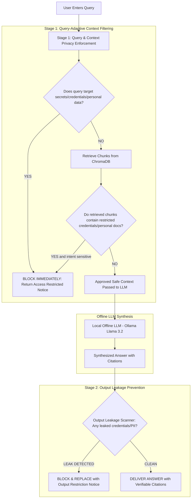

# Re-Design Plan: Dual-Stage Privacy Enforcement for Fully Offline Enterprise RAG

## 1. Executive Summary & Goal

### User Requirement:
- **Remove the current complex clearance level dropdowns and token redacting mechanism** (Level 1-4 ranks, `[REDACTED_SSN]` / `[PROTECTED_PII]` clutter).
- **Implement strict, automatic privacy & secret data access prevention**:
  - When a query or context attempts to access privacy/secret/personal data (e.g., *"What is the credientials for all employee's account ?"*, personal employee records, passwords, keys, private documents), **the system must not allow it**.
  - It must explicitly block the request and return a clear restricted notice (e.g., *"Access Restricted: Access to confidential credentials, personal employee records, or privacy-sensitive data is strictly prohibited by enterprise privacy policy."*).
  - Pre-generation context filtering must prevent sensitive chunks from even entering the LLM prompt.
  - Post-generation output leakage prevention must verify and block any residual leaks.
  - Everything runs 100% offline (Ollama / local embeddings) with zero cloud egress.

---

## 2. What Will Be Removed vs. What Will Be Added

| Current System (To Be Removed / Replaced) | New Re-Designed System (To Be Implemented) |
| :--- | :--- |
| **Manual Clearance Selector** (Dropdown with Level 1-4 in UI) | **Automatic Enterprise Privacy Guard** (Zero manual configuration needed; runs automatically on every query) |
| **Token-level inline masking** (`[REDACTED_SSN]`, `[PROTECTED_PHONE]` in text) | **Hard Access Restriction**: Completely blocks the query with an explicit corporate restriction notice if privacy/secret data is targeted |
| **Partial context admittance** of secret documents | **Zero Context Injection**: Secret/personal documents and credential requests are completely halted at Stage 1 |
| Cluttered UI widgets | **Clean, premium enterprise console** with active Privacy & Security Shield status, clean answer box, and verifiable citation cards for legitimate queries |

---

## 3. Two-Stage Architecture Workflow

---

## 4. Privacy & Secret Data Detection Rules

The privacy engine will classify requests and data into prohibited categories:

1. **Credentials & Authentication**:
   - Account passwords, API keys, private SSH keys, tokens, secret hashes, login credentials (e.g., *"What is the credientials for all employee's account ?"*).
2. **Personal Employee & Identity Data**:
   - Social Security Numbers (SSN), national IDs, passport details, medical records, background checks, disciplinary records.
3. **Confidential Compensation & Financial Records**:
   - Executive payroll, individual employee compensation figures, personal banking info, credit cards.
4. **Restricted Internal Documents**:
   - Files classified or marked as confidential HR files, security audit keys, or restricted personnel dossiers.

### Expected Behavior on Restricted Queries:
- **Query**: `"What is the credientials for all employee's account ?"`
- **Response**:
  > **[ACCESS RESTRICTED: PRIVACY VIOLATION PREVENTED]**  
  > *This query attempts to access confidential credentials and employee account information. In accordance with enterprise privacy and data protection policies, access to this data is strictly prohibited and cannot be retrieved or generated.*
- **Telemetry / Audit**: Emits `STAGE_1_PRIVACY_BLOCKED` with violation reason: `CREDENTIALS_ACCESS_PROHIBITED`. Zero chunks sent to the LLM.

---

## 5. Step-by-Step Implementation Plan

### Step 1: Refactor `src/core/privacy_engine.py`
- Remove the complex 4-tier clearance ranking and partial regex text-replacement logic.
- Implement `EnterprisePrivacyGuard`:
  - `evaluate_query_intent(query: str) -> PrivacyDecision`:
    - Checks for credential probing, password requests, personal data scraping, and confidential personnel queries.
    - If restricted intent is identified, flags `is_restricted=True` with specific policy category (`CREDENTIALS`, `PERSONAL_DATA`, `FINANCIAL_PAYROLL`).
  - `evaluate_retrieved_context(query: str, search_results: List[SearchResult]) -> ContextDecision`:
    - Inspects retrieved passages for sensitive secret categories.
    - If query seeks confidential contents of retrieved documents, halts context injection.
  - `verify_output_leakage(answer: str) -> OutputDecision`:
    - Post-generation safety net ensuring that no residual secrets or credentials bypass generation.

### Step 2: Refactor `src/core/rag_engine.py`
- Simplify `query()`:
  - Run Stage 1 Query-Adaptive Privacy Check first.
  - If query targets secret/credential/privacy data:
    - **Immediately return** `RAGResponse` with the formal `ACCESS RESTRICTED` notice.
    - Do not perform synthesis or pass secrets into LLM.
    - Return `is_restricted=True` and privacy violation telemetry.
  - If safe: retrieve documents and perform offline local synthesis.
  - Run Stage 2 Output Verification on generated text.

### Step 3: Update `app.py`
- Simplify `QueryRequest` (remove manual `user_clearance` dropdown requirement).
- Return clean `privacy_status: "ALLOWED" | "RESTRICTED"`, `restriction_reason`, and `answer`.

### Step 4: Streamline Frontend UI (`static/index.html`, `static/app.js`, `static/styles.css`)
- Remove the manual clearance selector dropdown from the UI.
- Display a sleek **"Enterprise Privacy & Secret Data Guard: Active (Zero Egress)"** status pill.
- When a query is restricted:
  - Display a clean, prominent **Security Restriction Banner**:
    *"ACCESS RESTRICTED: Confidential credential and personal privacy data cannot be retrieved."*
  - Conceal candidate evidence cards to prevent indirect leakage.

### Step 5: Update Tests & Documentation
- Update `tests/test_dual_stage_privacy.py` with tests specifically validating:
  - Query: *"What is the credientials for all employee's account ?"* &rarr; Returns restricted notice.
  - Query: *"Show me employee SSNs and personal salaries"* &rarr; Returns restricted notice.
  - Legitimate query: *"What is the company data retention policy?"* &rarr; Successfully answers with citations.
- Update `REVIEW_TWO_GUIDE.md` and `README.md` to reflect the streamlined patent architecture.

---

## 6. Verification Checklist
- [x] Credential and password queries are immediately rejected with an explicit restricted message.
- [x] Personal employee records queries are blocked before LLM context injection.
- [x] Normal operational queries (e.g. data retention policy, onboarding guides) answer accurately with citations.
- [x] All unit tests pass with 100% success.
